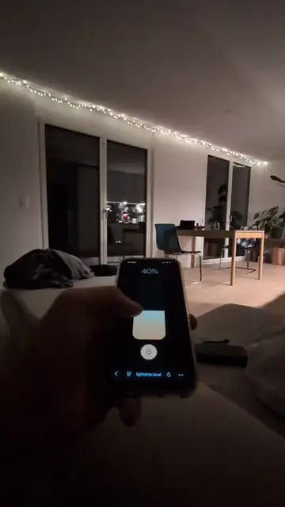
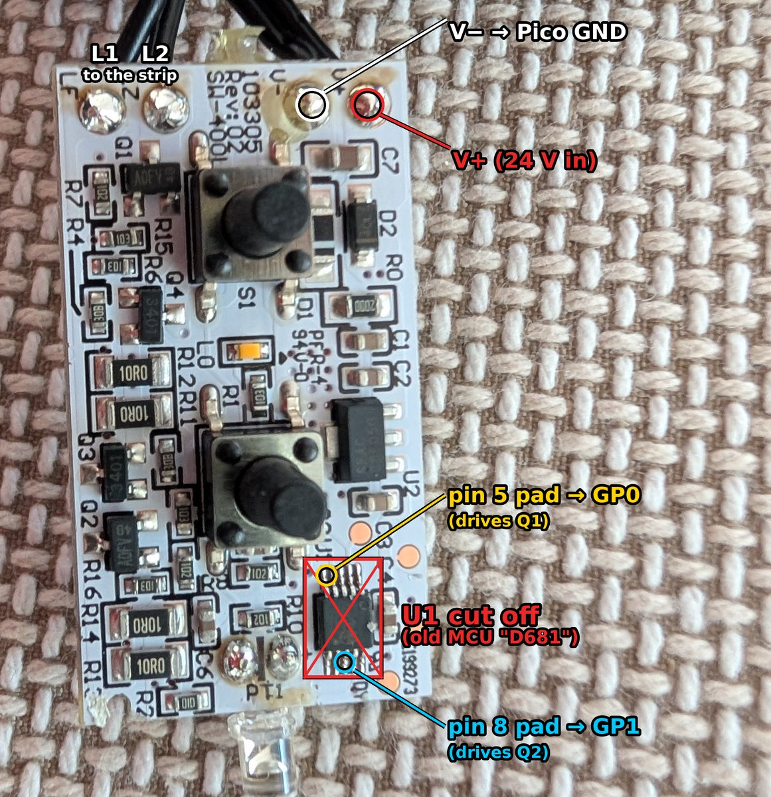
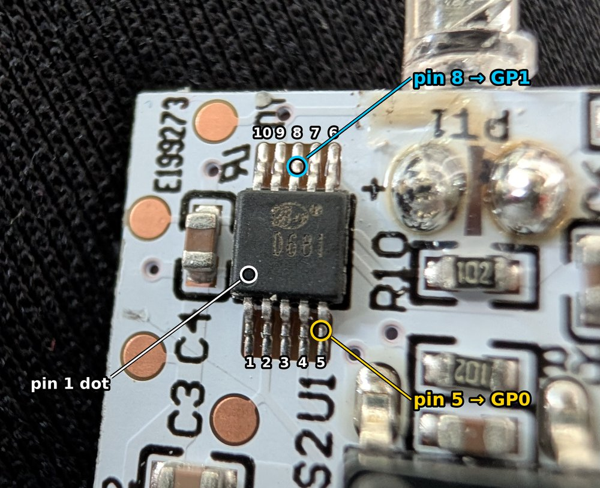
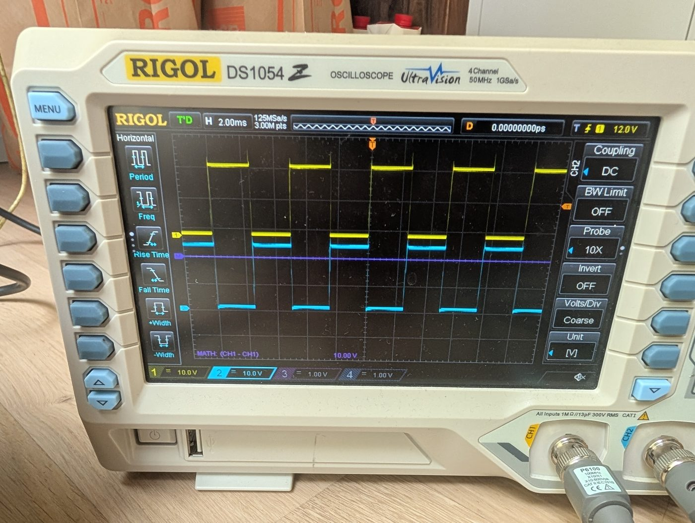
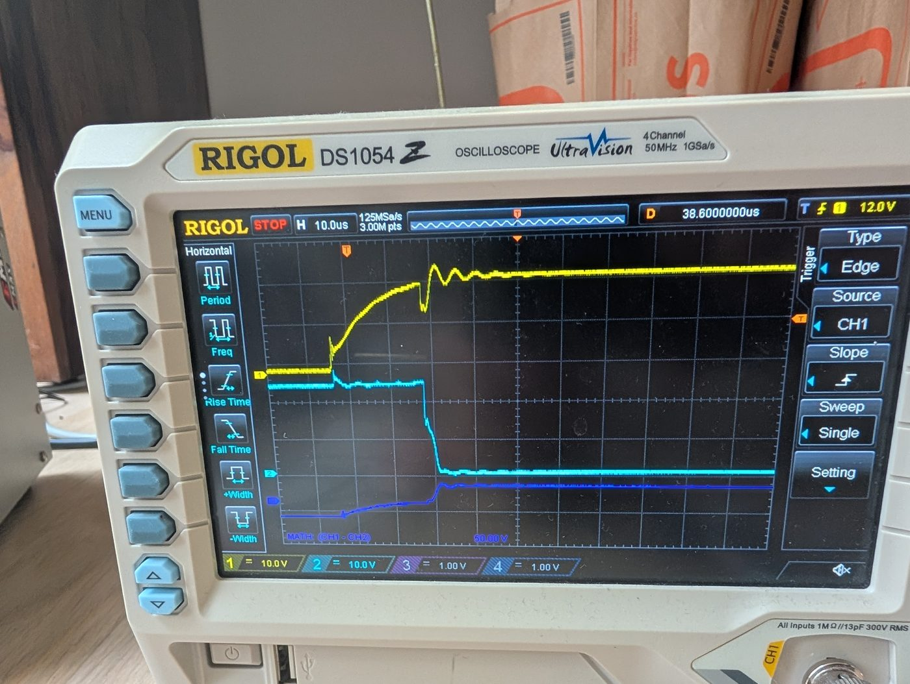
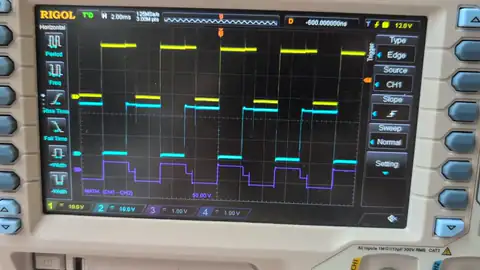

# IKEA light strip controller (Pico W)

<p align="center">
  <a href="docs/media/demo.mp4"></a><br>
  <sub>Dimming the strip from the phone (<a href="docs/media/demo.mp4">full video</a>)</sub>
</p>

Smoothly dimmable 24 V IKEA LED strip, controlled from your phone over the local network.
The original controller's microcontroller (U1) was removed; a Raspberry Pi Pico W now drives
the board's H-bridge directly. Hardware details and measurements are in
[`led-controller-context.md`](led-controller-context.md).

Open **http://&lt;the Pico's IP&gt;/** on a phone on the same Wi-Fi: one big slider plus an on/off
button. The IP is printed over USB at boot and written to `net.log`. Give the Pico a fixed IP in
your router; many routers also make it reachable by name (`lightstrip.local` via mDNS, or the
router's own DNS name for the hostname `lightstrip`).

## Files (all copied to the Pico)

| File | What it does |
|---|---|
| `main.py` | Runs at power-up: OTA server, fader, web server, and Wi-Fi with a self-check (see below) |
| `ota.py` | Updates over Wi-Fi (port 8080, token-protected). Independent of the app, so it survives a broken `light.py`/`web.py` |
| `bridge.py` | H-bridge driver (PIO). Enforces the safety rules: never both outputs on, ≥ 30 µs dead time |
| `light.py` | Brightness state, smooth fading, brightness cap, saves the last setting to flash |
| `web.py` | Serves the page and a WebSocket for live control (no external libraries) |
| `index.html` | The phone page |
| `config.py` | Wi-Fi networks, hostname, country code, OTA token. **Contains secrets, don't share it** |
| `state.json` | Created on the Pico: last brightness and on/off, restored at power-up |
| `net.log` | Created on the Pico: connects, outages, reconnects and errors (UTC) |

Laptop-only tools: `push.py` (updates over Wi-Fi) and `dev_server.py` (local preview of the page).

## Hardware: how the original board is reused

Full measurements are in [`led-controller-context.md`](led-controller-context.md); this is the short version.

### The strip needs alternating polarity

The strip has only two wires, and its LEDs are wired **anti-parallel**: half of them light up with
current in one direction, the other half with current in the other direction. To light the whole
strip, the voltage across it has to keep flipping polarity, so it needs an **H-bridge**, not
just a switch.

```
          A          B          A          B
 L1 ──────┬──────────┬──────────┬──────────┬────── …
          │          │          │          │
         ─┴─        ─┴─        ─┴─        ─┴─
         \ /        / \        \ /        / \
         ─┬─        ─┬─        ─┬─        ─┬─
          │          │          │          │
 L2 ──────┴──────────┴──────────┴──────────┴────── …

 A = LED pointing L1 → L2: lights when L1 is + (GP0 pulse: Q3 + Q1 on)
 B = LED pointing L2 → L1: lights when L2 is + (GP1 pulse: Q4 + Q2 on)
```

| Phase | L1 | L2 | Lit |
|---|---|---|---|
| GP0 pulse | V+ | GND | A LEDs |
| GP1 pulse | GND | V+ | B LEDs |
| Gap / off | V+ (floating) | V+ (floating) | none |

The bridge alternates A and B 1000 times a second, so to the eye the whole strip glows evenly.
Both halves always get the same pulse width, so they're always equally bright.

This shows the typical layout of two-wire light strings, with every other LED facing the other
way. What's known for certain is that half the LEDs light per polarity. The exact arrangement
inside the strip (e.g. single LEDs or small series groups between the wires) wasn't measured.

### The original controller board

The IKEA controller board ("103305 Rev:02") already has that H-bridge. It's driven by a small
10-pin microcontroller (U1, marked "D681"). U1 couldn't be identified and is almost certainly
one-time-programmable, so it was **cut off the board**. The Pico W now drives the bridge through
U1's empty pads. The rest of the board stays as it is: the supply input V+/V− with its
reverse-polarity diode D2, the bridge, and the strip outputs L1/L2. Its other parts are unused
for now: the 78L05 regulator that powered U1, the buttons S1/S2, the light sensor PT1 and the
indicator LED.

<p align="center">
  
  
</p>

*Left: the board before the change, with U1 still on it (bottom right, crossed out). The Pico is
soldered to the pads of U1's pin 5 (→ GP0) and pin 8 (→ GP1), and its GND to V−. The pad
silkscreen reads "LF LZ V- V+": LF/LZ are L1/L2. Right: U1 close-up (the board is upside down
here). Pin 1 is at the dot; pins 1–5 run along one side, 6–10 back along the other.*

**The original firmware on the scope** (outputs L1 = yellow, L2 = cyan, measured before U1 was removed):

<p align="center">
  
  
</p>

*Left, 2 ms/div: the outputs take turns being pulled low, 2.5 ms each, so the polarity flips at
200 Hz. Right, 10 µs/div: at a changeover, the released output (yellow) floats up slowly and the
other one (cyan) is pulled low about 22 µs later. That gap is the dead time the new firmware
keeps at ≥ 30 µs.*

<p align="center">
  <a href="docs/media/scope_original_pulsing.mp4"></a><br>
  <sub>One of the original firmware's effect modes ("pulsing") on the scope (<a href="docs/media/scope_original_pulsing.mp4">full video</a>)</sub>
</p>

### The H-bridge: four MOSFETs, two control wires


*Drawn with [schemdraw](https://schemdraw.readthedocs.io/) from [`docs/hbridge_schematic.py`](docs/hbridge_schematic.py)
(`pip install schemdraw matplotlib`, then `python3 docs/hbridge_schematic.py`).*

- **Low side (Q1, Q2, N-channel):** each is switched directly by one control wire, through a 1 kΩ
  resistor. A 10 kΩ pull-down keeps it off while nothing drives it, e.g. while the Pico boots.
- **High side (Q3, Q4, P-channel):** these have **no control wire of their own**. Each P-MOSFET's
  gate sits on a divider between V+ (2 kΩ) and the **opposite** output (10 kΩ). That's why the
  board only needs two wires. Both sides are mirror images of each other.

**How one wire turns on a whole current path**, with GP0 as the example:

1. GP0 goes high and Q1 switches on, pulling **L2 to ground**.
2. Q3's gate is now on a divider between V+ and L2 = 0 V, so it sits about 4 V below V+
   (24 V × 2 kΩ / 12 kΩ). That switches the P-MOSFET Q3 on, and **L1 goes to V+**.
3. Current flows V+ → Q3 → L1 → strip → L2 → Q1 → GND, which lights one half of the LEDs.

GP1 does the mirror image: Q2 pulls L1 low, Q4 switches on, L2 goes to V+, and current flows the
other way through the strip, lighting the other half.

**Off:** when neither wire is high, both outputs float up to V+ through the gate resistors.
There's 0 V across the strip, so it's dark. On a scope, "both outputs at V+" is the normal off state.

The Pico's 3.3 V through the 1 kΩ / 10 kΩ divider gives about 3.0 V at the gate, enough for these
logic-level MOSFETs (AO3400-type N, AO3401 P).

### The one dangerous state

If **GP0 and GP1 are high at the same time**, both low sides pull both outputs to ground, and
that turns both high sides on too. Then each leg conducts straight from V+ to GND
(**shoot-through**), shorting the supply. The high side also switches off slowly (its gate
recharges through the 2 kΩ pull-up), so there must be a **gap (dead time)** between one wire
going low and the other going high. The original firmware used 22 µs; this one uses 30 µs.

### How the Pico drives it

A PIO state machine (`bridge.py`) alternates the two wires in hardware, independent of Python.
It pulses GP0, waits, pulses GP1, waits, and repeats:

```
          ┌────┐                      ┌────┐
GP0  ─────┘    └──────────────────────┘    └──────────────────
                     ┌────┐                      ┌────┐
GP1  ────────────────┘    └──────────────────────┘    └───────
          |<-- 0.5 ms -->|
          pulse width = brightness; the gap between pulses is always ≥ 30 µs
```

- 1 kHz polarity cycle (the original ran at 200 Hz), 0.1 µs resolution for the pulse width.
- Overlap is impossible by construction: the program only ever sets one pin, and the maximum
  pulse width is clamped so the gap can never get shorter than 30 µs.
- Brightness goes through a gamma curve (2.2) so the slider feels even. Slider 1 % maps to the
  shortest pulse that still visibly lights the strip, and 100 % is capped at 93 % for the power supply.

## Wiring

The Pico's wires are soldered to U1's empty pads:

| Pico W | Board |
|---|---|
| GP0 (pin 1) | old U1 pin 5 pad → Q1 (L1 high / L2 low) |
| GP1 (pin 2) | old U1 pin 8 pad → Q2 (L2 high / L1 low) |
| GND (pin 3) | V− |

### Power: one 24 V supply for everything

The Pico runs from the strip's own 24 V supply, through a small buck converter with a fixed 3.3 V
output into **VSYS**. No separate USB power is needed.

```
24 V (V+) ──► buck 24 → 3.3 V (fixed) ──► VSYS (pin 39)
V− ─────────► buck GND ─────────────────── GND  (pin 38)
```

- **VSYS, not the 3V3 pin:** VSYS accepts 1.8–5.5 V and feeds the Pico's own regulator. The 3V3 pin
  is that regulator's output.
- **The buck must handle the input voltage:** rated for ≥ 28 V input (e.g. not the 23 V "Mini-360").
- **USB at the same time** (for updates over the cable): put a Schottky diode (e.g. 1N5819) between
  the buck and VSYS, so USB power can't flow back into the buck. Updates over Wi-Fi don't need USB at all.
- **Power budget:** the supply is rated **0.15 A**. The strip alone draws about 137 mA at full
  brightness (measured), and the Pico adds roughly 20 mA through the buck (short Wi-Fi spikes ~40 mA),
  which would slightly exceed the rating. So the slider's 100 % is capped at 93 % (`MAX_LEVEL` in
  `light.py`, about 85 % power): strip ≈ 117 mA + Pico ≈ 20 mA ≈ 137 mA in total, under the rating.
  With the gamma curve, the cap is barely visible.

## Updating over Wi-Fi (normal way)

```bash
python3 push.py light.py index.html   # upload; reboots automatically if a .py file changed
python3 push.py --log                 # connection/outage/error log
python3 push.py --ls | --get <file> | --reboot
```

`.py` files are syntax-checked on the Pico before they replace the old file. A logic bug in
`light.py`/`web.py` still leaves the OTA server running. Only `main.py`, `ota.py` and `config.py`
can break updates over Wi-Fi if wrong (push.py asks before uploading those). A reboot turns the
light off for ~5 s, then it fades back to its saved state. `index.html` needs no reboot.

## Previewing the page locally

```bash
python3 dev_server.py        # http://localhost:8000/, also reachable from the phone via the laptop's IP
```

Uses the real `web.py` with a fake light. Edit `index.html` and refresh. When happy: `python3 push.py index.html`.

## First install over USB

Needs [`mpremote`](https://docs.micropython.org/en/latest/reference/mpremote.html) (`pip install mpremote`)
and MicroPython for the Pico W (tested with v1.29). Close Thonny first; it holds the USB port.

```bash
# cp config.example.py config.py, then fill in NETWORKS, COUNTRY, PICO_HOST, OTA_TOKEN
mpremote cp bridge.py light.py web.py ota.py index.html config.py main.py : + reset
```

The on-board LED is lit while connecting to Wi-Fi. Connecting with Thonny or mpremote stops the
program; unplug/replug or press Ctrl-D to start it again.

## How it works

- **Phone → Pico:** the page keeps one WebSocket open and sends the slider value up to ~60×/s.
  If the network is busy it drops stale values, so the light always follows the latest position.
  The connection closes when the phone locks and reconnects when you come back.
- **Pico:** a 200 Hz fader eases toward the target (≈40 ms smoothing while dragging, 0.4 s fade for
  on/off) and calls `bridge.set_brightness()`, which applies gamma 2.2.
- **Slider:** it's relative-drag (it doesn't jump to where you touch), so you can fine-tune a level.
  Several phones stay in sync after each change.
- **Wi-Fi power saving is off** for low latency (~15–20 ms round trip).
- At power-up the light fades in to the last saved setting. Settings are written to flash 3 s after the last change.
- If the program crashes, the Pico reboots after 5 s. Errors are written to `net.log`.

### Wi-Fi robustness

- `config.NETWORKS` is tried in order, so a second network can act as fallback. Hidden SSIDs work.
  Each attempt restarts the Wi-Fi chip.
- **Self-check:** every 30 s the Pico opens a TCP connection to the router (port 80). After 3 failures
  in a row (re-checked every 5 s) it reconnects. This catches a state seen with some access points,
  where the Pico still counts as connected but unicast frames no longer reach it (broadcasts still
  do). Detection plus reconnect takes about a minute.
- Everything is logged to `net.log`, with the clock synced over NTP (router first, then `pool.ntp.org`).

## Settings worth knowing

| Where | Setting | Default |
|---|---|---|
| `light.py` | `MAX_LEVEL`: brightness cap (slider 100 % → this) | `0.93` (~85 % power) |
| `light.py` | `SLIDE_TAU_MS`, `TOGGLE_MS`: smoothing / on-off fade | `40`, `400` |
| `light.py` | `MIN_LEVEL`: slider 1 % → this (shorter pulses don't light the strip) | `0.075` (~2 µs pulse) |
| `config.py` | `NETWORKS`: Wi-Fi networks, tried in order | — |
| `config.py` | `COUNTRY`: Wi-Fi regulatory country; `"XX"` only allows channels 1–11 | `"XX"` |
| `config.py` | `PICO_HOST`: the Pico's address, used by `push.py` on the laptop | — |
| `bridge.py` | timing (`POL_HZ`, `DEAD_US`) | 1 kHz, 30 µs |

## Safety rules (from the hardware notes)

1. GP0 and GP1 must never be high at the same time (shoot-through). The PIO program makes this impossible.
   A crash in the Python/web code can't violate it.
2. Dead time ≥ 30 µs; the maximum pulse is clamped so it can't shrink.
3. After **any** change to timing in `bridge.py`, test first **without the strip** at a low current limit:
   the supply should draw only a few mA.
4. Never connect a 5 V signal from the board (old button pull-ups, PT1 sensor, 78L05 rail) to a Pico pin.
5. Keep Pico GND tied to V−.

## Caveats

- **No login.** Anyone on the Wi-Fi can control the light. Don't expose it to the internet.
- **mDNS:** `lightstrip.local` depends on the access point. It worked through one access point,
  but stopped working when the Pico joined a different router's Wi-Fi with the same firmware,
  probably because that router filters mDNS. A fixed IP always works.
- **Low end:** where exactly the strip starts to glow depends on the hardware. Tune `MIN_LEVEL` so
  slider 1 % just barely lights it.
