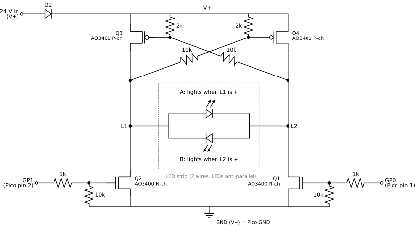

# IKEA light strip controller (Pico W)

Smoothly dimmable 24 V IKEA LED strip, controlled from your phone over the local network.
The original controller's microcontroller (U1) was removed; a Raspberry Pi Pico W now drives
the board's H-bridge directly. Hardware details and measurements are in
[`led-controller-context.md`](led-controller-context.md).

Open **http://lightstrip.fritz.box/** (or **http://192.168.178.38/**) on a phone on the same Wi-Fi:
one big slider plus an on/off button.

## Files (all copied to the Pico)

| File | What it does |
|---|---|
| `main.py` | Runs at power-up: OTA server, fader, web server, and Wi-Fi with a self-check (see below) |
| `ota.py` | Updates over Wi-Fi (port 8080, token-protected). Independent of the app, so it survives a broken `light.py`/`web.py` |
| `bridge.py` | H-bridge driver (PIO). Enforces the safety rules: never both outputs on, ≥ 30 µs dead time |
| `light.py` | Brightness state, smooth fading, brightness cap, saves the last setting to flash |
| `web.py` | Serves the page and a WebSocket for live control (no external libraries) |
| `index.html` | The phone page |
| `config.py` | Wi-Fi networks, hostname, country code, OTA token. **Contains secrets, don't share it** |
| `state.json` | Created on the Pico: last brightness and on/off, restored at power-up |
| `net.log` | Created on the Pico: connects, outages, reconnects and errors (UTC) |

Laptop-only tools: `push.py` (updates over Wi-Fi) and `dev_server.py` (local preview of the page).

## Hardware: how the original board is reused

Full measurements are in [`led-controller-context.md`](led-controller-context.md); this is the short version.

### The strip needs alternating polarity

The strip has only two wires, and its LEDs are wired **anti-parallel**: half of them light up with
current in one direction, the other half with current in the other direction. To light the whole
strip, the voltage across it has to keep flipping polarity, so it needs an **H-bridge**, not
just a switch.

```
          A          B          A          B
 L1 ──────┬──────────┬──────────┬──────────┬────── …
          │          │          │          │
         ─┴─        ─┴─        ─┴─        ─┴─
         \ /        / \        \ /        / \
         ─┬─        ─┬─        ─┬─        ─┬─
          │          │          │          │
 L2 ──────┴──────────┴──────────┴──────────┴────── …

 A = LED pointing L1 → L2: lights when L1 is + (GP0 pulse: Q3 + Q1 on)
 B = LED pointing L2 → L1: lights when L2 is + (GP1 pulse: Q4 + Q2 on)
```

| Phase | L1 | L2 | Lit |
|---|---|---|---|
| GP0 pulse | V+ | GND | A LEDs |
| GP1 pulse | GND | V+ | B LEDs |
| Gap / off | V+ (floating) | V+ (floating) | none |

The bridge alternates A and B 1000 times a second, so to the eye the whole strip glows evenly.
Both halves always get the same pulse width, so they're always equally bright.

This shows the typical layout of two-wire light strings, with every other LED facing the other
way. What's known for certain is that half the LEDs light per polarity. The exact arrangement
inside the strip (e.g. single LEDs or small series groups between the wires) wasn't measured.

### The original controller board

The IKEA controller board ("103305 Rev:02") already has that H-bridge. It's driven by a small
10-pin microcontroller (U1, marked "D681"). U1 couldn't be identified and is almost certainly
one-time-programmable, so it was **cut off the board**. The Pico W now drives the bridge through
U1's empty pads. The rest of the board stays as it is: the supply input V+/V− with its
reverse-polarity diode D2, the bridge, and the strip outputs L1/L2. Its other parts are unused
for now: the 78L05 regulator that powered U1, the buttons S1/S2, the light sensor PT1 and the
indicator LED.

### The H-bridge: four MOSFETs, two control wires



*Drawn with [schemdraw](https://schemdraw.readthedocs.io/) from [`docs/hbridge_schematic.py`](docs/hbridge_schematic.py)
(`pip install schemdraw matplotlib`, then `python3 docs/hbridge_schematic.py`).*

- **Low side (Q1, Q2, N-channel):** each is switched directly by one control wire, through a 1 kΩ
  resistor. A 10 kΩ pull-down keeps it off while nothing drives it, e.g. while the Pico boots.
- **High side (Q3, Q4, P-channel):** these have **no control wire of their own**. Each P-MOSFET's
  gate sits on a divider between V+ (2 kΩ) and the **opposite** output (10 kΩ). That's why the
  board only needs two wires. Both sides are mirror images of each other.

**How one wire turns on a whole current path**, with GP0 as the example:

1. GP0 goes high and Q1 switches on, pulling **L2 to ground**.
2. Q3's gate is now on a divider between V+ and L2 = 0 V, so it sits about 4 V below V+
   (24 V × 2 kΩ / 12 kΩ). That switches the P-MOSFET Q3 on, and **L1 goes to V+**.
3. Current flows V+ → Q3 → L1 → strip → L2 → Q1 → GND, which lights one half of the LEDs.

GP1 does the mirror image: Q2 pulls L1 low, Q4 switches on, L2 goes to V+, and current flows the
other way through the strip, lighting the other half.

**Off:** when neither wire is high, both outputs float up to V+ through the gate resistors.
There's 0 V across the strip, so it's dark. On a scope, "both outputs at V+" is the normal off state.

The Pico's 3.3 V through the 1 kΩ / 10 kΩ divider gives about 3.0 V at the gate, enough for these
logic-level MOSFETs (AO3400-type N, AO3401 P).

### The one dangerous state

If **GP0 and GP1 are high at the same time**, both low sides pull both outputs to ground, and
that turns both high sides on too. Then each leg conducts straight from V+ to GND
(**shoot-through**), shorting the supply. The high side also switches off slowly (its gate
recharges through the 2 kΩ pull-up), so there must be a **gap (dead time)** between one wire
going low and the other going high. The original firmware used 22 µs; this one uses 30 µs.

### How the Pico drives it

A PIO state machine (`bridge.py`) alternates the two wires in hardware, independent of Python.
It pulses GP0, waits, pulses GP1, waits, and repeats:

```
          ┌────┐                      ┌────┐
GP0  ─────┘    └──────────────────────┘    └──────────────────
                     ┌────┐                      ┌────┐
GP1  ────────────────┘    └──────────────────────┘    └───────
          |<-- 0.5 ms -->|
          pulse width = brightness; the gap between pulses is always ≥ 30 µs
```

- 1 kHz polarity cycle (the original ran at 200 Hz), 0.1 µs resolution for the pulse width.
- Overlap is impossible by construction: the program only ever sets one pin, and the maximum
  pulse width is clamped so the gap can never get shorter than 30 µs.
- Brightness goes through a gamma curve (2.2) so the slider feels even. Slider 1 % maps to the
  shortest pulse that still visibly lights the strip, and 100 % is capped at 93 % for the power supply.

## Wiring

The Pico's wires are soldered to U1's empty pads:

| Pico W | Board |
|---|---|
| GP0 (pin 1) | old U1 pin 5 pad → Q1 (L1 high / L2 low) |
| GP1 (pin 2) | old U1 pin 8 pad → Q2 (L2 high / L1 low) |
| GND (pin 3) | V− |

### Standalone power (instead of USB)

```
24 V (V+) ──► buck 24→3.3 V ──►|── VSYS (pin 39)
V− ─────────► buck GND ─────────── GND  (pin 38)
                          Schottky diode (e.g. 1N5819), needed if USB may also be plugged in
```

- Use **VSYS**, not the 3V3 pin. VSYS accepts 1.8–5.5 V.
- The buck converter must be rated for ≥ 28 V input (not the 23 V "Mini-360" type). Set it to 3.3 V before connecting.
- Current budget at 24 V: strip at the 93 % cap ≈ 117 mA + Pico ≈ 20 mA (Wi-Fi spikes ~40 mA) ≈ 137 mA, under the 0.15 A supply.

## Updating over Wi-Fi (normal way)

```bash
python3 push.py light.py index.html   # upload; reboots automatically if a .py file changed
python3 push.py --log                 # connection/outage/error log
python3 push.py --ls | --get <file> | --reboot
```

`.py` files are syntax-checked on the Pico before they replace the old file. A logic bug in
`light.py`/`web.py` still leaves the OTA server running. Only `main.py`, `ota.py` and `config.py`
can break updates over Wi-Fi if wrong (push.py asks before uploading those). A reboot turns the
light off for ~5 s, then it fades back to its saved state. `index.html` needs no reboot.

## Previewing the page locally

```bash
python3 dev_server.py        # http://localhost:8000/, also reachable from the phone via the laptop's IP
```

Uses the real `web.py` with a fake light. Edit `index.html` and refresh. When happy: `python3 push.py index.html`.

## First install over USB

Needs [`mpremote`](https://docs.micropython.org/en/latest/reference/mpremote.html) (`pip install mpremote`)
and MicroPython for the Pico W (tested with v1.29). Close Thonny first; it holds the USB port.

```bash
# cp config.example.py config.py, then fill in NETWORKS, COUNTRY, OTA_TOKEN
mpremote cp bridge.py light.py web.py ota.py index.html config.py main.py : + reset
```

The on-board LED is lit while connecting to Wi-Fi. Connecting with Thonny or mpremote stops the
program; unplug/replug or press Ctrl-D to start it again.

## How it works

- **Phone → Pico:** the page keeps one WebSocket open and sends the slider value up to ~60×/s.
  If the network is busy it drops stale values, so the light always follows the latest position.
  The connection closes when the phone locks and reconnects when you come back.
- **Pico:** a 200 Hz fader eases toward the target (≈40 ms smoothing while dragging, 0.4 s fade for
  on/off) and calls `bridge.set_brightness()`, which applies gamma 2.2.
- **Slider:** it's relative-drag (it doesn't jump to where you touch), so you can fine-tune a level.
  Several phones stay in sync after each change.
- **Wi-Fi power saving is off** for low latency (~15–20 ms round trip).
- At power-up the light fades in to the last saved setting. Settings are written to flash 3 s after the last change.
- If the program crashes, the Pico reboots after 5 s. Errors are written to `net.log`.

### Wi-Fi robustness

- `config.NETWORKS` is tried in order: `wlan2` (FRITZ!Box, hidden SSID) first, `wlan` (Archer AX10)
  as fallback. Each attempt restarts the Wi-Fi chip.
- **Self-check:** every 30 s the Pico opens a TCP connection to the router (port 80). After 3 failures
  in a row (re-checked every 5 s) it reconnects. This catches a state seen with the Archer AX10
  access point, where the Pico still counts as connected
  but unicast frames no longer arrive. Detection plus reconnect takes about a minute.
- Everything is logged to `net.log` with the time synced from the FRITZ!Box.

## Settings worth knowing

| Where | Setting | Default |
|---|---|---|
| `light.py` | `MAX_LEVEL`: brightness cap (slider 100 % → this) | `0.93` (~85 % power) |
| `light.py` | `SLIDE_TAU_MS`, `TOGGLE_MS`: smoothing / on-off fade | `40`, `400` |
| `config.py` | `NETWORKS`: Wi-Fi networks, tried in order | `wlan2`, then `wlan` |
| `config.py` | `COUNTRY`: Wi-Fi regulatory country (`"XX"` would only allow channels 1–11) | `"CH"` (channels 1–13) |
| `bridge.py` | timing (`POL_HZ`, `DEAD_US`) | 1 kHz, 30 µs |

## Safety rules (from the hardware notes)

1. GP0 and GP1 must never be high at the same time (shoot-through). The PIO program makes this impossible.
   A crash in the Python/web code can't violate it.
2. Dead time ≥ 30 µs; the maximum pulse is clamped so it can't shrink.
3. After **any** change to timing in `bridge.py`, test first **without the strip** at a low current limit:
   the supply should draw only a few mA.
4. Never connect a 5 V signal from the board (old button pull-ups, PT1 sensor, 78L05 rail) to a Pico pin.
5. Keep Pico GND tied to V−.

## Caveats

- **No login.** Anyone on the Wi-Fi can control the light. Don't expose it to the internet.
- **Address:** the FRITZ!Box always gives the Pico `.38` and resolves `lightstrip.fritz.box` for every
  device that uses it as DNS (all devices on `wlan`/`wlan2`). `lightstrip.local` (mDNS) works on the
  laptop but not reliably on Android phones.
- The dimmest few percent of the slider may look uneven (see To do).

## To do

- [ ] **Dark-end calibration:** add a raw pulse-length test, find the shortest clean pulse (`MIN_ON`) on the scope
  (Math CH1−CH2 reaches full 24 V with a flat top, both polarities glow evenly), then map slider 1 % → `MIN_ON`.
  If still steppy: dither between n and n+1 cycles; pulse skipping only if even dimmer is needed (flicker risk).
- [ ] Delete the old `test.py` from the Pico (contains credentials for another network).
- [ ] Optional: reuse buttons S1/S2 and the PT1 sensor (check for 5 V pull-ups first).
